Een uitgebreidere status, die straks ook (samengevat) zal bezorgd worden aan de andere sympathisanten, al of niet financieel ondersteunend.

Vanaf 16.10.2026 ontvangen we alle conclusies van de tussenkomende partijen, waarop we moeten reageren tegen 16.11.2026 (= finaal standpunt onze advocaat).

Schrik dus niet als u even geen updates meer ontvangt.

## 3 nieuwe vragen/verzoeken tot tussenkomst deze week : de financiële procedureslag gaat verder !

Opvallendste tussenkomst is die van het “**Burgercollectief Stille Vlucht**”, 28 inwoners uit vnl. Gr. Bijgaarden en Bodegem (Noord-Dilbeek), met toch een aantal opvallende maar niet onverwachte namen (de voorzitters van beide Dorpsraden, alsook een aantal actievelingen op FB (Facebook) “Vliegenvanger” waaronder onze zogezegde overbezorgde luchtvaart”expert” van “alle” Dilbekenaren, …). Het waren ook zij trouwens die organisator waren van de Dil’Arte toelichting op 28.08.2025 met onze inmiddels ontslagen ombudsman.

- Zij ontkennen vnl. de onwettige invoering van de RNP07L, en willen vooral geen terugkeer naar de vroeger VOR07L route, of wat hadden jullie verwacht.

- 13 jaar lieten ze maar begaan, en nu het gelukt is om de route zuidwaards te verplaatsten nemen ze voor het eerst juridisch actie tegen de verkeerde partij dan nog, en dan maar op FB verkondigen dat ze “een eerlijke verdeling” willen en juridische acties geen zin hebben, om dan nog te zwijgen van het feit dat de 3 dorpsraden (incl. Kapelle) ons eind 2025 niet wensten te ontvangen voor overleg (zelfs na 4 mails niet).

- Ook in Noord-Dilbeek zijn de maskers nu afgevallen; het weze duidelijk dat de motie van 2018 niet zomaar een motie was, en allerminst met in achtname van “alle” Dilbekenaren, maar dat hier een bewuste strategie achter zat/zit !

Verder ook voorlopig 2 vragen tot vrijwillige tussenkomst van “**Free Air 4 Brussels**” die onze belangen mee verdedigen, en “**Waterloo en Sint-Genesius-Rode**“ zo goed als zeker tegen; van beide mochten we momenteel nog geen verdere stukken ontvangen.

Dus **Pro** :

1. 42 gezinnen (“Dilbeek, Lennik, OLV Lombeek”) *– Verbist Advocatuur*
2. Molenbeek (& Co) - *Athos*
3. Koekelberg - *Boutembourg*
4. “Free Air 4 Brussels” (of afvaardiging van 200 Brusselse gezinnen ervan) – *Solar Advocaten*

En **Contra** :

1. Belgische Staat - *Portico*
2. Skeyes (gedwongen tussenkomst) - *Daldewolf*
3. SP Woluwe - *Boullart*
4. “Kraainem en Wezembeek Oppem (& Co)” - *Wysen*
5. Jette - *HSP*
6. Noordrandgemeenten (“Vilvoorde, Machelen, Meise, Grimbergen en Wemmel”) – *VS Advocaten*
7. Burgercollectief “Stille Vlucht” (Noord-Dilbeek) – *Xirius advocaten*
8. “Waterloo en Sint-Genesius-Rode” - *Industrious*

En dit los van de procedure van Lennik, en los van de procedure van het Brussels Gewest.

De eerste conclusies van de vrijwillig tussenkomende partijen worden nu ingewacht tegen 16.10.2026, waarna wij tegen 16.11.2026 onze enige conclusies moeten neerleggen. 

## Het “plan” Crucke van 01.10.2026 : Hogere interceptie (4.000 voet ipv 3.000 voet) en steilere dalingshoek (3,2 graden ipv 3,0 graden) !?!

-  Hoe lang kan een minister nog aanblijven en verdere nonsens verklaren ? Cfr. [de Kamer](https://media.dekamer.be/meeting/56-020305-U2088)" deze woensdagmorgen 07.10.2026 (10u) : minuut 00:00 tot 27:00.

- Voor eerst “**LIEGT**” Crucke : enkel de interceptie 4.000 voet is ingevoerd, en Crucke weet hiervan !

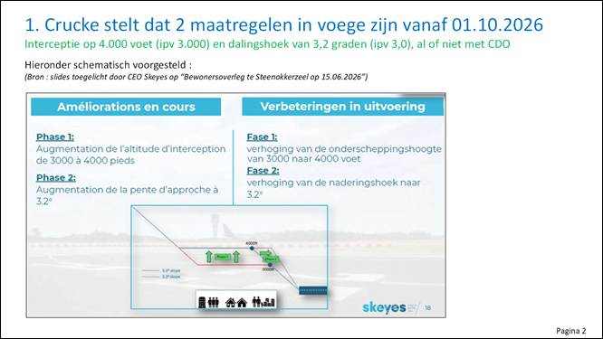

- Ook al hadden beide tegelijkertijd ingevoerd, Crucke wist dat ze sowieso geen impact gingen hebben, integendeel ze treffen nog meer inwoners onder de route !

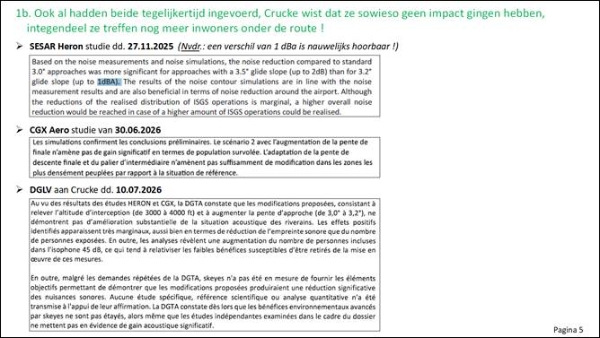

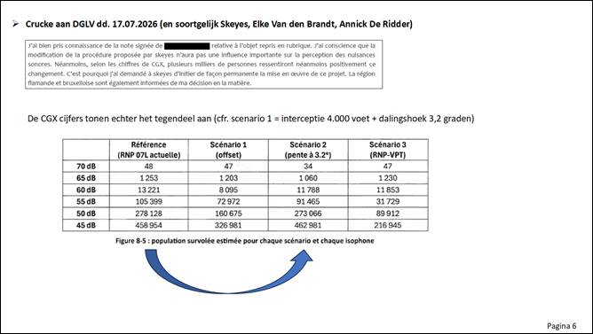

- Menig mens met iets of wat gezond boerenbestand had dit al kunnen voorspellen, en hebben het ook afgelopen zondag 04.10.2026 (14u02-16u18) kunnen ondervinden, nu ook in Pajottegem.

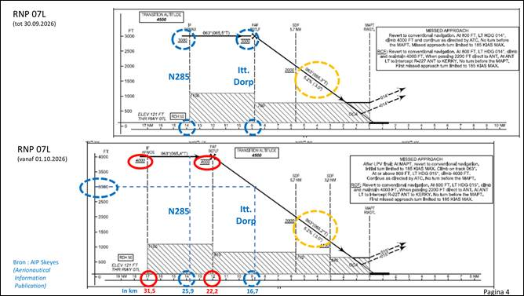

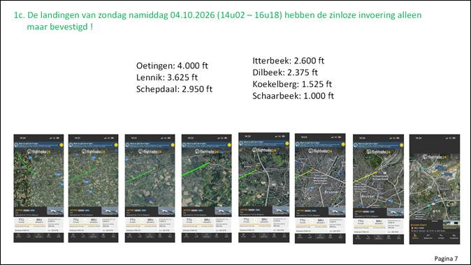

- Crucke heeft nu 3 studies dat huidige RNP07L de meest slechte is.

  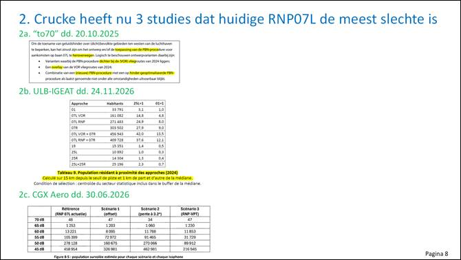

  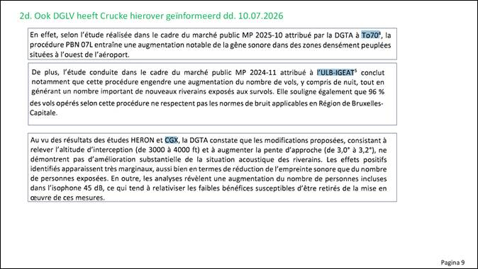

​      

- Crucke maakt RNP07L vanaf 01.10.2026 nu “permanent” ipv “tijdelijk” (alweer “en stoemelings”, zonder verdere communicatie), en verbiedt het gebruik van de VOR07L tot eind 2026 !

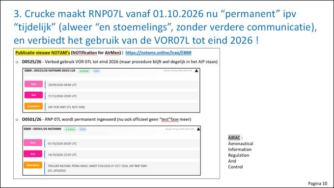

- Crucke bestendigt hierbij de onwettelijke invoering (zoals ook de DGLV nu op 10.07.2026 laat uitblijken).

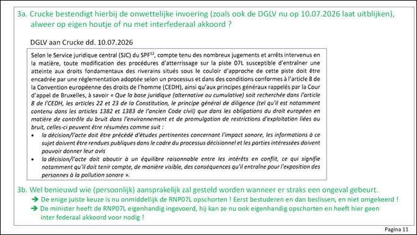

- Wie gelooft nog in alle beloofde maatregelen van Crucke zoals uiteengezet in zijn perscommuniqué van 01.10.2026, neen alweer niet via het kabinet ontvangen, maar via-via (cfr. bijlage).

 

## In Lennik is de boodschap alvast doorgedrongen !

[Facebook post van Irina De Knop, burgemeester Lennik](https://www.facebook.com/watch/?v=1574411700554595)

## Details van het Departement Omgeving Vlaanderen 

Inmiddels hebben we meer detail ontvangen van het Departement Omgeving Vlaanderen mbt de geluidsoverlast (meetstation Itterbeek-Dorp). De verdere en gedetailleerde gevolgen van fijn stof edm kennen we, buiten algemeen aanvaarde studies, niet !

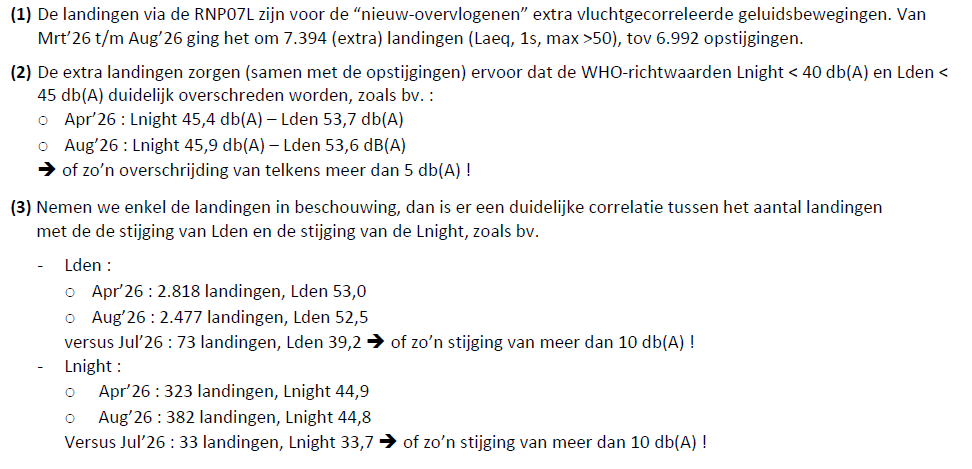

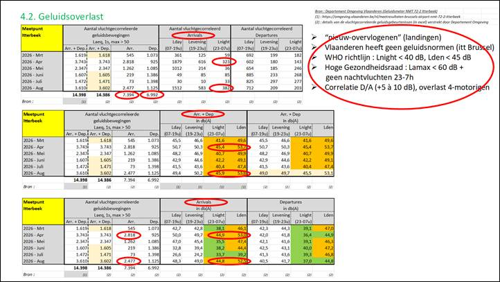

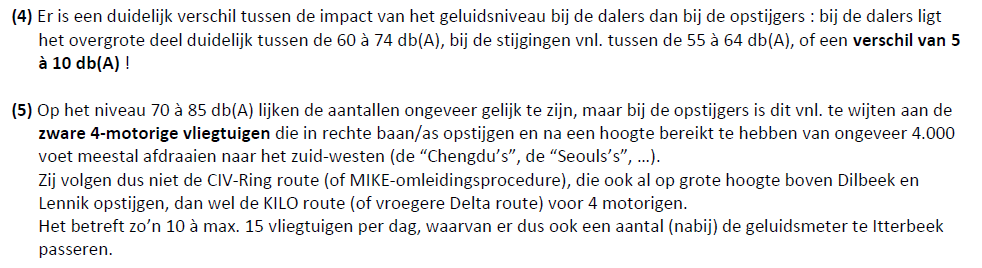

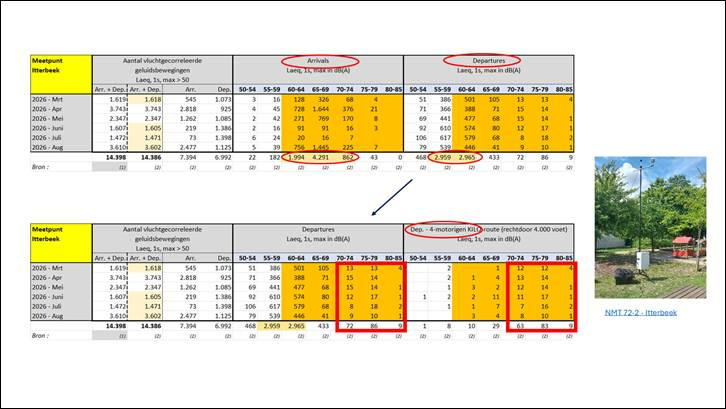

 

## Crowdfunding en financiële status

15.000 Eur gestort door burgers, 5.000 Eur door één bedrijf.

Het lijken grote bedragen, maar laat ons ook een kat een kat noemen, **voor een rechtszaak dat we nu begroten op minstens 75.000 Eur** gezien alle tussenkomende partijen (zonder verder hoger beroep), en wetende dat een paar burgers hier al meer dan een jaar dag en nacht mee bezig zijn, **kan ik mijn teleurstelling toch niet verbergen**.

Zeker niet als dit de bijdrage is van 83 (niet gemandateerde) burgers, op de nu 3.000 verspreide flyers (van de 3.500) onder de directe route !

Mvg Eddy

 

### Voor de geïnteresseerde lezer (waarvan ook al een aantal berichten of FB verschenen) :

 

**Onderzoek Bruzz dd. 29.09.2026**

[Dataonderzoek naar vlieglawaai: Oostenwind verklaart lang niet alle landingen op baan 07L | BRUZZ](https://www.bruzz.be/actua/mobiliteit/oostenwind-verklaart-lang-niet-alle-nachtlandingen-op-baan-07l-2026-09-29?fbclid=IwY2xjawUouIVleHRuA2FlbQIxMQBwZG9mAXNydGMGYXBwX2lkEDIyMjAzOTE3ODgyMDA4OTIAAR59YyXTLuEx_LE27gB3rGj5YgtcJKLxhpcLA7Y1dLZYNuvqBdq68Lfp4CvGrw_aem_QoI1Hj8eeDAUwiK6zn5ELA)

 

**De Tijd : waarom steeds meer vliegtuigen boven Brussel landen**

[Waarom steeds meer vliegtuigen boven Brussel landen](https://multimedia.tijd.be/interactief/vliegroutes-brussel/)

 

**VRT Max - Radio 1 - De wereld vandaag - 01 oktober 2026**

**Geluidshinder luchthaven : helpt hoger vliegen en steiler dalen ..**

[Geluidshinder luchthaven: helpt hoger vliegen en steiler dalen? | VRT MAX](https://www.vrt.be/vrtmax/luister/radio/d/de-wereld-vandaag~11-10/de-wereld-vandaag~11-39125-0/fragment~c9c37891-cead-4b4a-9ff9-9e71e2335fd9/?ndl=true&fbclid=IwY2xjawUtwLNleHRuA2FlbQIxMABwZG9mAXNydGMGYXBwX2lkEDIyMjAzOTE3ODgyMDA4OTIAAR6Ko95ce3j8LW_6LOyune6FYLpq7q3NP452p5yzaKT8fUdim7-NBZeQoi5DDg_aem_Uh-bfucp2HRAaiI5rXNCzA)

... of hoe een piloot op een begrijpelijke manier toelicht dat de hogere interceptie en de lagere dalingshoek voor de meeste Lennikenaars en Dilbekenaars niets zal uithalen, als evenmin voor Brussel, wat Crucke ook beweert !

Daarenboven wordt Pajottegem nu bijkomend geïmpacteerd !

 