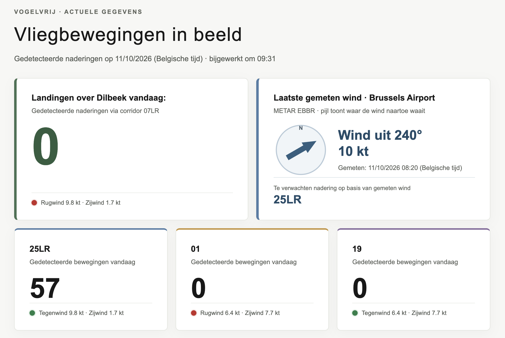
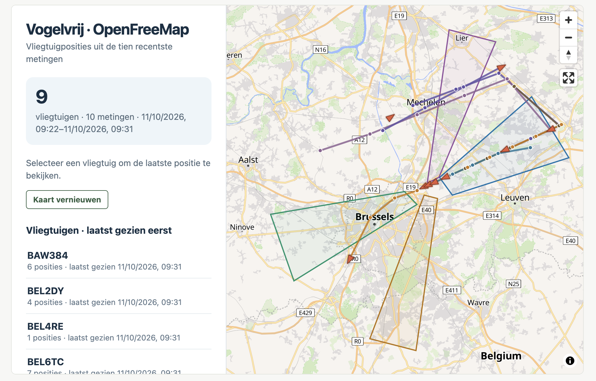

Vanaf nu vindt u op onze website actuele informatie over het vliegverkeer in de omgeving van Brussels Airport. Op de kaart kunt u recente vliegbewegingen volgen en zien langs welke kant vliegtuigen de luchthaven naderen of ervan wegvliegen. Zo krijgt u als buurtbewoner een duidelijker beeld van wat er boven onze regio gebeurt.

De website toont ook hoeveel naderingen in de verschillende vliegroutes werden waargenomen, samen met een overzicht van de meest recente bewegingen. De gegevens worden regelmatig bijgewerkt, zodat u veranderingen doorheen de dag en over meerdere dagen kunt volgen.

Ook de wind speelt een belangrijke rol. Daarom tonen we de actuele wind en de voorspelling voor de komende uren. Op basis daarvan geeft de website aan welke naderingsbaan waarschijnlijk gebruikt zal worden. Dat blijft een verwachting: de werkelijke keuze wordt door de luchtverkeersleiding gemaakt en hangt ook af van andere omstandigheden.

## Voortaan ook nieuws en achtergrond

Nieuw is ook onze rubriek **Nieuws**. Daar delen we voortaan berichten, achtergrondinformatie en updates over onze werking. De nieuwste artikels verschijnen meteen op de startpagina; via de nieuwspagina kunt u alle berichten nalezen.

## Enkele voorbeelden

### Overzicht van de landingen vandaag:

### Kaart met actuele vluchten

